# Machine Learning Research

A machine learning research project for tabular regression. The repository contains exploratory data analysis, feature engineering, classical machine learning models, gradient boosting, neural networks, ensemble optimization, and experiments with additional synthetic-data-based features.

The project was developed for the Kaggle **Playground Series S6E1** competition. The main objective was to compare different modeling approaches, investigate their errors, and improve prediction quality on the leaderboard.

## Table of Contents

- [Project Overview](#project-overview)
- [Repository Structure](#repository-structure)
- [Experimental Results](#experimental-results)
- [Exploratory Data Analysis](#exploratory-data-analysis)
- [Feature Engineering](#feature-engineering)
- [Models and Experiments](#models-and-experiments)
- [Installation](#installation)
- [Running the Notebooks](#running-the-notebooks)
- [Source Code](#source-code)
- [Reproducibility Notes](#reproducibility-notes)
- [License](#license)

## Project Overview

The repository investigates several approaches to tabular regression:

- Exploratory data analysis and outlier investigation.
- Feature engineering and feature selection.
- Linear regression models and K-nearest neighbors.
- Decision trees and random forests.
- Gradient boosting with LightGBM, XGBoost, and CatBoost.
- Neural networks, including MLP, ResNet, and TabM architectures.
- Residual analysis and ensemble optimization.
- Hill-climbing-based model blending.
- Experimental feature engineering using synthetic data.
- Final model comparison using Kaggle public and private leaderboard scores.

The experiments are organized as Jupyter notebooks, while shared utilities, model implementations, configuration handling, and prediction logic are stored in `src/`.

## Repository Structure

```text
.
├── LICENSE
├── config.ini
├── notebooks/
│   ├── boosting.ipynb
│   ├── eda.ipynb
│   ├── ensemble.ipynb
│   ├── hillclimbers.ipynb
│   ├── knn.ipynb
│   ├── linear_models.ipynb
│   ├── speculative.ipynb
│   ├── tabm.ipynb
│   ├── tabmlp.ipynb
│   ├── tabresnet.ipynb
│   └── trees.ipynb
├── pyproject.toml
├── src/
│   ├── backend.py
│   ├── config.py
│   ├── config_parser.py
│   ├── lgbm_cuda.py
│   ├── nn/
│   │   ├── litmlp.py
│   │   ├── litmodel.py
│   │   ├── litresnet.py
│   │   ├── littabm.py
│   │   ├── mlp.py
│   │   ├── regressor.py
│   │   ├── resblock.py
│   │   ├── resnet.py
│   │   └── seblock.py
│   ├── optimizer.py
│   ├── predict.py
│   ├── test.py
│   └── visualization.py
└── uv.lock
```

## Experimental Results

The following table summarizes the main standalone model results reported during the experiments. The local results use the reported out-of-fold (OOF) evaluation for the 80/20 split. Lower RMSE and MAE indicate better predictive performance.

### Standalone model comparison

| Model | OOF RMSE | OOF MAE |
|---|---:|---:|
| LightGBM | 8.745640 | 6.971381 |
| XGBoost | 8.745786 | 6.970028 |
| CatBoost | 8.770060 | 6.994335 |
| Random Forest | 8.864690 | 7.076111 |
| TabResNet | 8.864597 | 7.081814 |
| TabMLP | 8.840737 | 7.056353 |
| TabM | 8.843348 | 7.067799 |
| Ridge Regression | 8.883888 | 7.090298 |
| Linear Regression | 8.883889 | 7.090300 |
| ElasticNet | 8.883938 | 7.090466 |
| Lasso | 8.884075 | 7.090617 |
| Decision Tree | 9.062328 | 7.194081 |
| K-Nearest Neighbors | 9.157392 | 7.333010 |
| Dummy Regressor | 18.859002 | 15.490848 |

**Interpretation:** Gradient boosting achieved the best standalone performance among the reported baseline models. LightGBM and XGBoost had nearly identical RMSE, while XGBoost had a marginally lower MAE. KNN and the single decision tree performed worse than the boosting models. The Dummy Regressor provided a baseline demonstrating that the trained models learned useful relationships in the data.

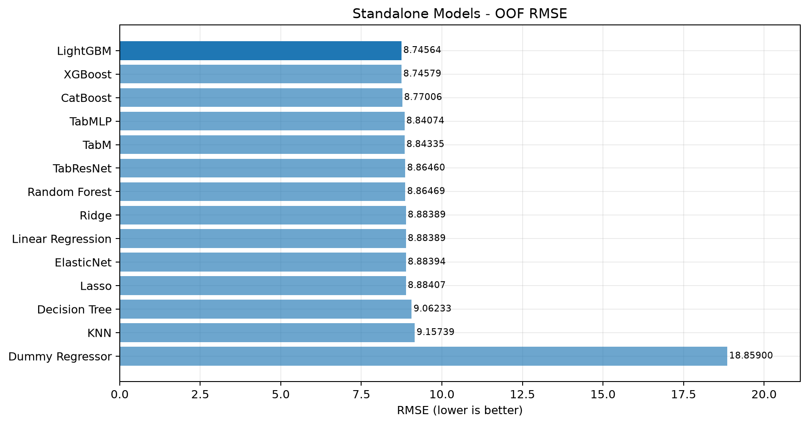

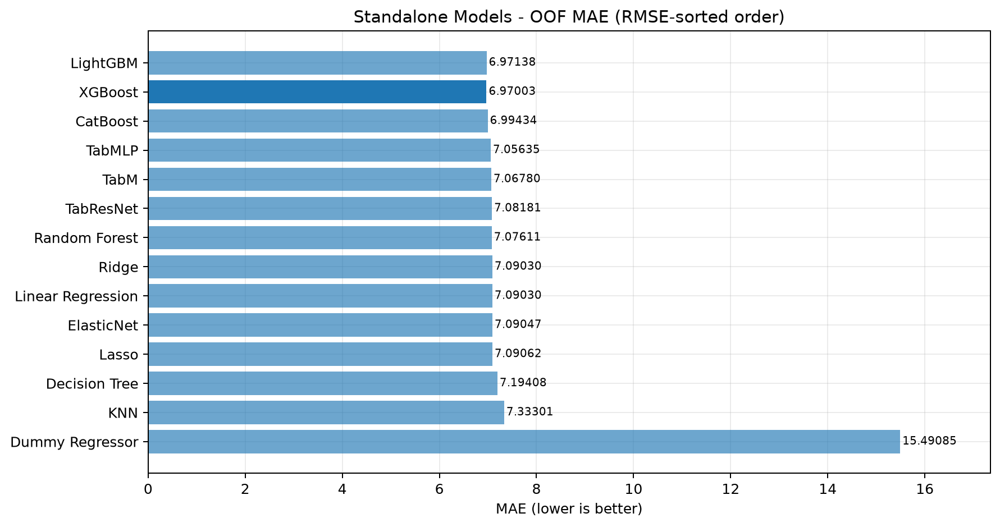

### Final Kaggle leaderboard comparison

The final submission experiments compared hill-climbing ensemble blending with CatBoost trained on original and engineered features.

| Approach | Public RMSE | Private RMSE |
|---|---:|---:|
| Hill-climbing ensemble | 8.68173 | 8.71180 |
| CatBoost with original features | 8.72428 | 8.74838 |
| **CatBoost with engineered features** | **8.62019** | **8.65025** |

The CatBoost model with speculative feature engineering achieved the best reported public and private leaderboard scores.

Compared with CatBoost using the original features, the engineered-feature model improved RMSE by:

- **0.10409** on the public leaderboard.
- **0.09813** on the private leaderboard.

Compared with the hill-climbing ensemble, the engineered-feature CatBoost model improved RMSE by:

- **0.06154** on the public leaderboard.
- **0.06155** on the private leaderboard.

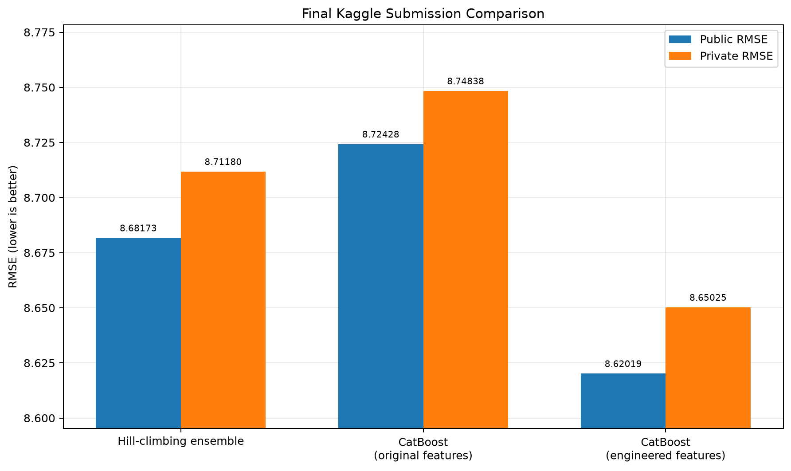

## Exploratory Data Analysis

The EDA notebook examines the dataset's structure, feature distributions, relationships between variables, and potential outliers.

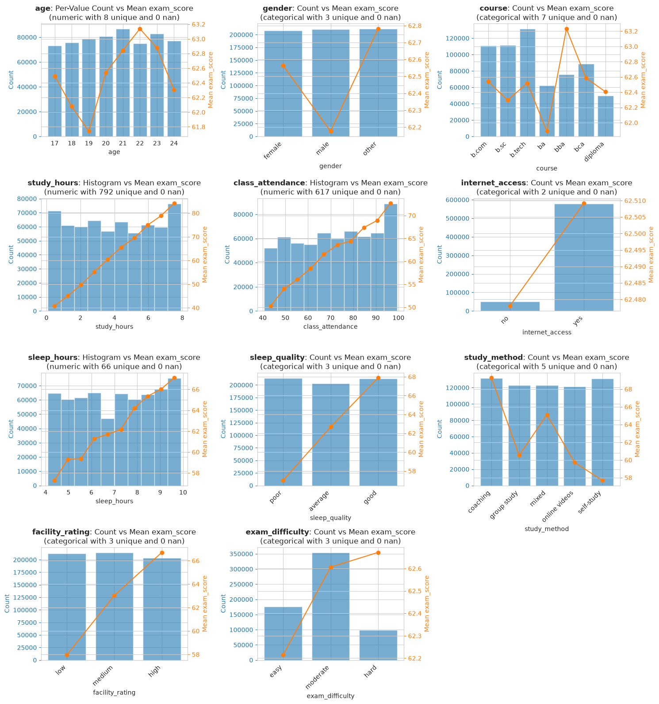

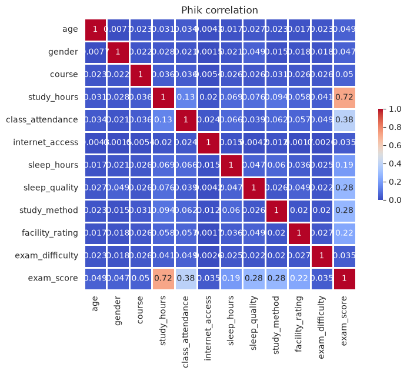

### Key observations

- No missing values were found in the inspected dataset.
- No duplicate rows were found.
- Target distribution was approximately normal, although many observations were concentrated at the minimum or maximum values.
- Study hours had a stronger relationship with the target than class attendance.
- The three examined correlation measures showed correlations of approximately 0.75 for `study_hours` and 0.35 for `class_attendance`.
- Isolation Forest flagged approximately 1% of observations as potential anomalies.
- PCA visualization placed the flagged observations near the edges of the projected feature space.
- Manual inspection did not reveal sufficiently strong evidence that these observations were invalid, so they were retained.

## Feature Engineering

The feature engineering experiments investigated whether simple domain-inspired transformations could improve the predictive signal.

Two derived features were introduced:

$$\text{study\\_efficiency} = \text{study\\_hours} \cdot \frac{\text{class\\_attendance}}{100}$$

$$\text{sleep\\_study\\_ratio} = \frac{\text{sleep\\_hours}}{\text{study\\_hours} + 10^{-6}}$$

The small constant in the denominator prevents division by zero.

Feature relevance was investigated using mutual information, XGBoost-based importance, and Boruta. `study_efficiency` and `study_hours` were identified as important features in these analyses.

All features were retained for subsequent experiments rather than removing features based on a single importance estimate.

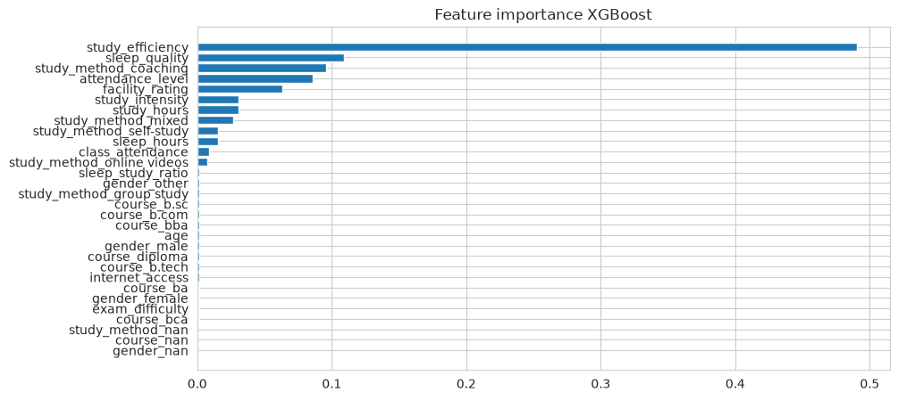

The `speculative.ipynb` notebook explores additional feature engineering ideas inspired by public Kaggle solutions and discussions:

- [Kaggle solution: 1st place](https://www.kaggle.com/competitions/playground-series-s6e1/writeups/1st-place-ive-ran-out-of-catchy-phrases-v)
- [RealMLP experiment](https://www.kaggle.com/code/mahoganybuttstrings/pg-s6e1-realmlp-cv-8-58748-lb-8-58006)
- [Kaggle discussion](https://www.kaggle.com/competitions/playground-series-s6e1/discussion/665915)

## Models and Experiments

### 1. Linear Models - `linear_models.ipynb`

The notebook evaluates Ridge Regression, Linear Regression, ElasticNet, Lasso, and a Dummy Regressor baseline.

The linear models achieved similar results, with RMSE close to 8.884. Their performance was substantially better than the Dummy Regressor, but slightly worse than gradient boosting.

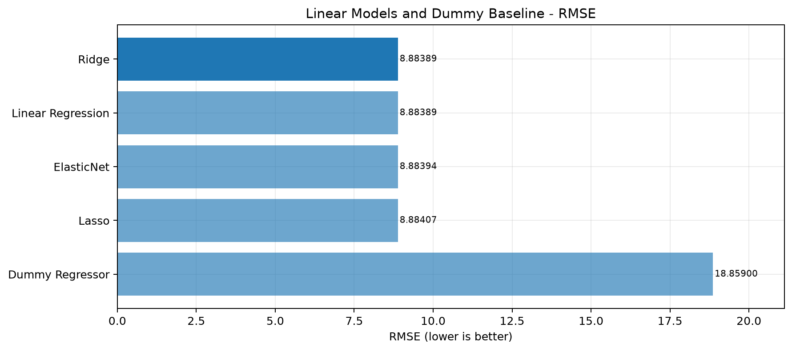

### 2. K-Nearest Neighbors - `knn.ipynb`

KNN was evaluated as a non-parametric baseline. Its reported RMSE was 9.157392 and MAE was 7.333010, making it weaker than the main linear and boosting baselines in these experiments.

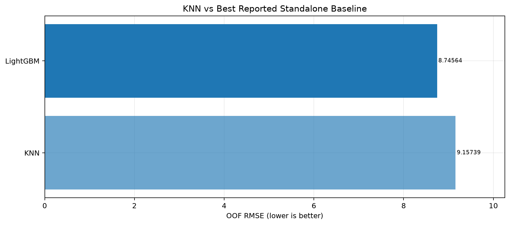

### 3. Tree-Based Models - `trees.ipynb`

The notebook compares Decision Tree and Random Forest models.

Random Forest performed better than a single Decision Tree, achieving RMSE of 8.864690 compared with 9.062328 for the Decision Tree.

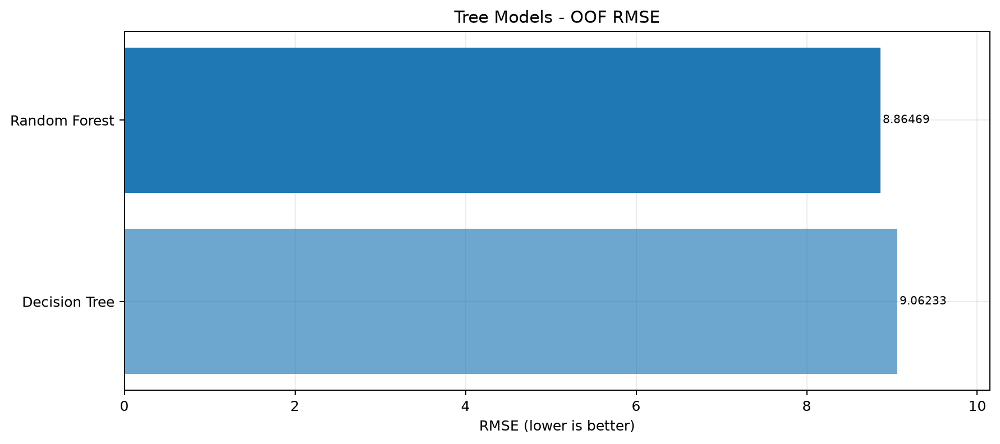

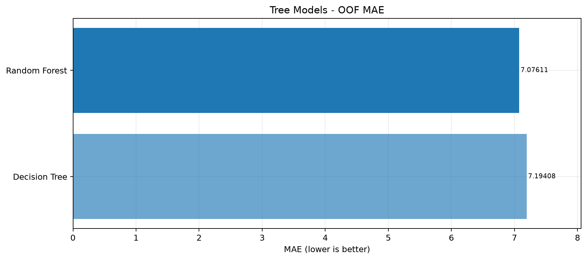

### 4. Gradient Boosting - `boosting.ipynb`

The boosting experiments compare LightGBM, XGBoost, and CatBoost.

All three models achieved strong results. LightGBM produced the lowest reported standalone RMSE, while XGBoost achieved a marginally lower MAE.

The final CatBoost experiment with additional engineered features outperformed the original-feature CatBoost model on both Kaggle leaderboard splits.

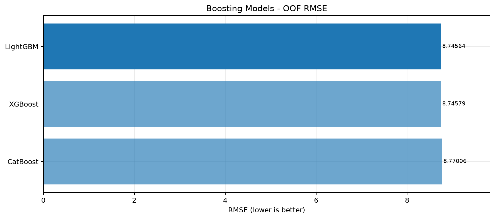

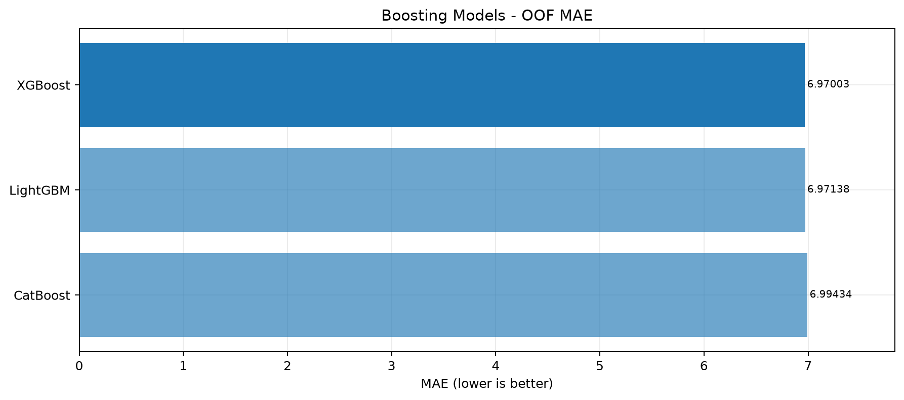

### 5. Neural Networks - `tabmlp.ipynb`, `tabresnet.ipynb`, `tabm.ipynb`

Three neural-network architectures were evaluated:

- **TabMLP** - a multilayer perceptron for tabular data.
- **TabResNet** - a residual neural network architecture.
- **TabM** - a specialized architecture for tabular prediction.

The reported OOF RMSE values were 8.840737 for TabMLP, 8.864597 for TabResNet, and 8.843348 for TabM. These results were competitive with the classical baselines but did not surpass the strongest standalone boosting models.

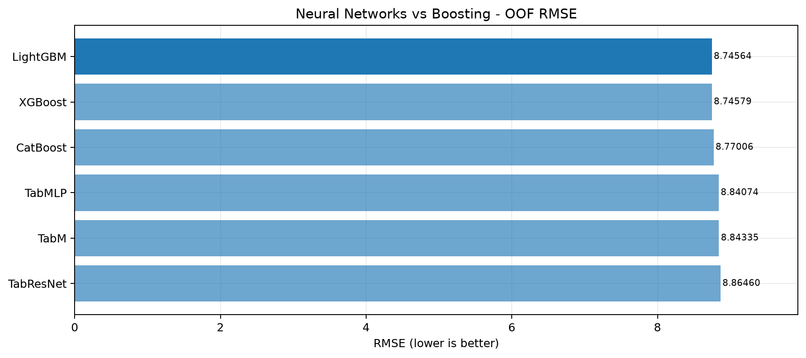

### 6. Ensemble Analysis - `ensemble.ipynb`

The ensemble notebook investigates whether combining models with different architectures can reduce prediction error.

The initial candidates were TabMLP, Ridge Regression, and LightGBM. Their residuals were highly correlated, with pairwise correlations around 0.99. This indicated limited error diversity and made large ensemble gains unlikely.

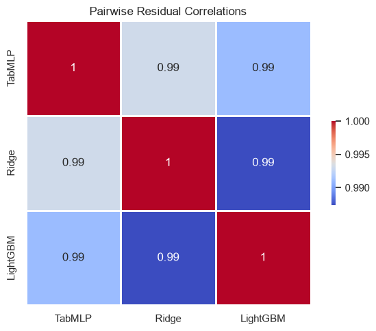

Residual analysis also showed a trend and heteroscedasticity: the magnitude and direction of errors varied with the target value. Under the convention $r = y_{\text{true}} - y_{\text{pred}}$, the observed positive trend suggested that predictions tended to be too high for lower target values and too low for higher values.

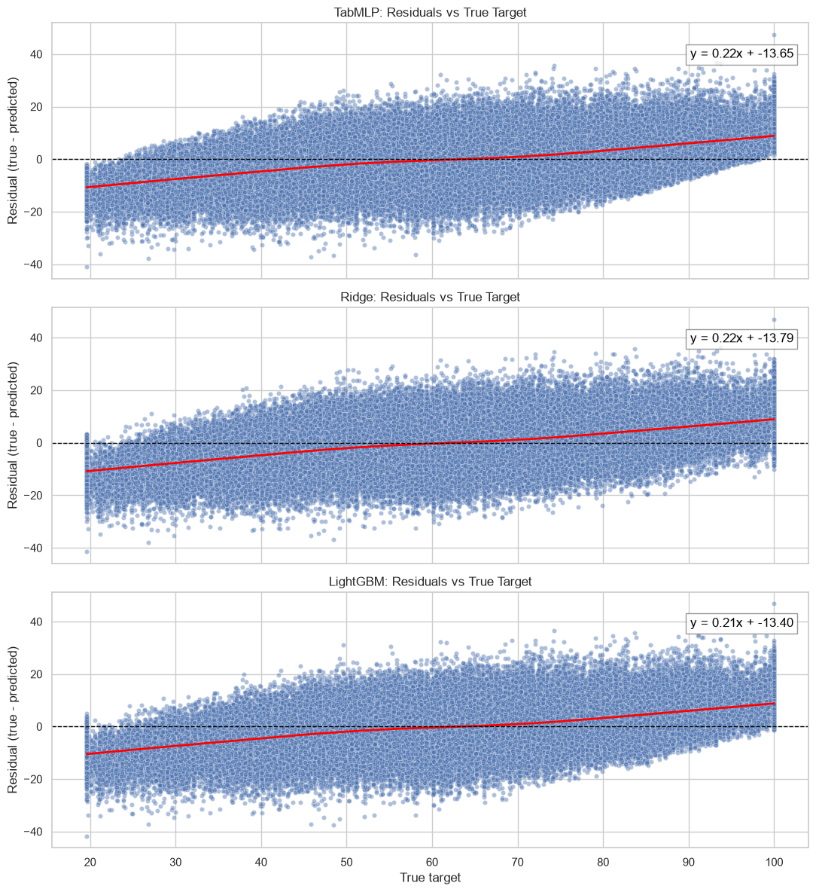

Optuna was used to optimize ensemble weights. The resulting ensemble was dominated by LightGBM and achieved RMSE of approximately 8.74762, slightly worse than the standalone LightGBM result of 8.74564.

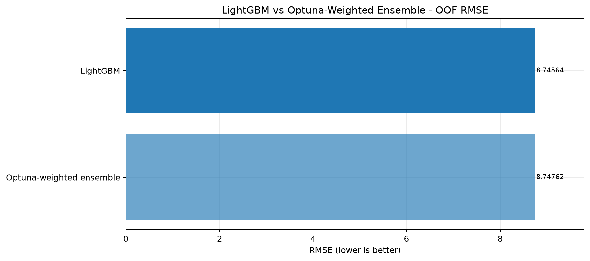

This experiment showed that adding models does not automatically improve performance. An ensemble is most useful when its components contribute complementary errors.

### 7. Hill-Climbing Ensemble - `hillclimbers.ipynb`

The hill-climbing notebook searches for a combination of model predictions that minimizes OOF RMSE.

The strongest standalone model in this experiment was XGBoost, with OOF RMSE of 8.73149. Hill-climbing progressively adjusted the blend by adding or modifying model weights. The final reported OOF RMSE was 8.72311, an improvement of approximately 0.00838 over standalone XGBoost.

The resulting Kaggle scores were:

- Public RMSE: 8.68173.
- Private RMSE: 8.71180.

The OOF improvement was modest, illustrating that model blending offered only a small gain for these predictions.

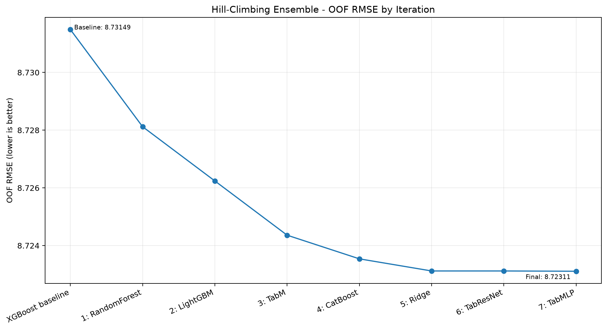

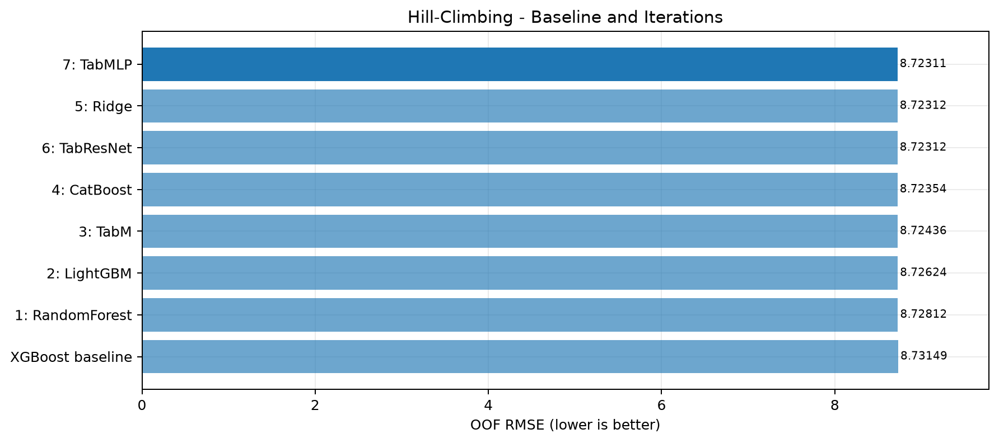

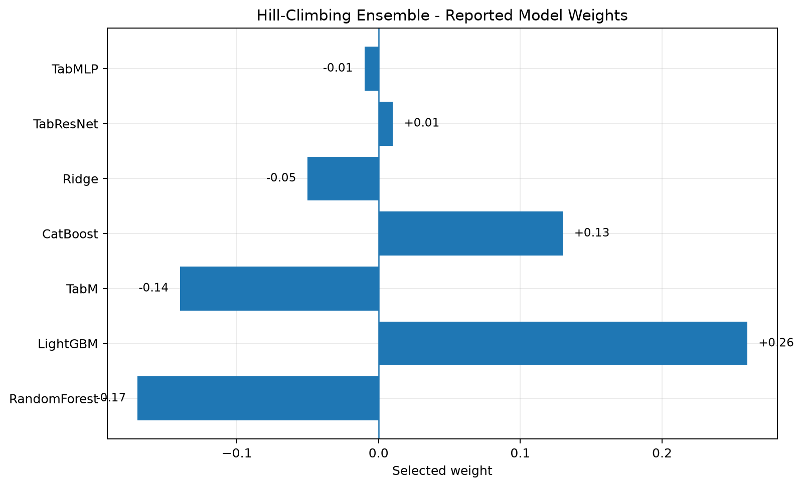

### 8. Speculative Feature Engineering - `speculative.ipynb`

This notebook investigates additional feature transformations inspired by external Kaggle solutions. The resulting features were evaluated with CatBoost, which can handle categorical variables natively.

CatBoost trained with the original features achieved Public RMSE of 8.72428 and Private RMSE of 8.74838. After adding the speculative features and increasing the number of iterations to 2,000, the scores improved to 8.62019 and 8.65025, respectively.

This was the strongest final submission among the reported approaches.

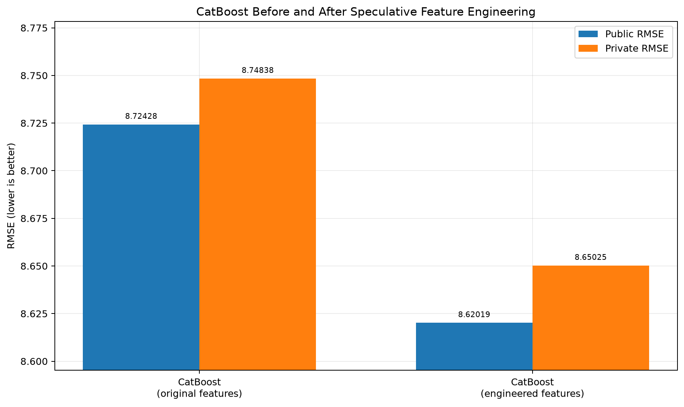

## Installation

The project uses **Python 3.12+** and [uv](https://docs.astral.sh/uv/) for dependency and environment management.

### Prerequisites

Install the following before running the notebooks:

- Python 3.12 or a compatible newer version.
- `uv`.
- Git, if cloning the repository.
- A compatible NVIDIA GPU and CUDA environment if GPU acceleration is required.

### 1. Clone the repository

```bash
git clone https://github.com/atrepalin/StudentScores
cd ml-research
```

### 2. Install uv

Follow the official installation instructions: https://docs.astral.sh/uv/getting-started/installation/

Verify the installation:

```bash
uv --version
```

### 3. Create the Python environment

Synchronize the environment using the committed lockfile:

```bash
uv sync
```

This installs the dependencies declared in `pyproject.toml` and resolved in `uv.lock`.

The project is configured as an environment rather than an installable Python package (`package = false`).

### 4. Install GPU-related dependencies manually

GPU-related packages are intentionally excluded from automatic dependency resolution. Their installation must be performed separately to match the operating system, Python version, GPU hardware, and CUDA runtime.

The excluded packages include:

- PyTorch (`torch`).
- CuPy (`cupy` or `cupy-cuda12x`).
- LightGBM (`lightgbm`), build manually for GPU support.
- RAPIDS cuML (`cuml` or `cuml-cu12`), when needed.

The project also declares a Windows-specific Triton build.

**Do not install every GPU package blindly.** Select compatible builds for the target machine and the notebooks being run.

For PyTorch, use the official installation selector to obtain the correct command for your OS and CUDA configuration: https://pytorch.org/get-started/locally/

For LightGBM GPU support, follow the official installation and build instructions: https://lightgbm.readthedocs.io/en/latest/Installation-Guide.html

For CuPy, select the package matching the installed CUDA environment: https://docs.cupy.dev/en/stable/install.html

For RAPIDS cuML, consult the official compatibility and installation guide: https://docs.rapids.ai/install/

After installing the required packages, verify that the imports and GPU initialization succeed before running the corresponding notebooks.

### 5. Launch Jupyter

Start Jupyter Notebook:

```bash
uv run jupyter notebook
```

Alternatively, start JupyterLab if it is installed:

```bash
uv run jupyter lab
```

Open the `notebooks/` directory and select the desired notebook.

## Running the Notebooks

The notebooks are intended to be run individually. Some experiments may depend on previously generated predictions, prepared data, or configuration values.

A suggested exploration order is:

| Order | Notebook | Purpose |
|---:|---|---|
| 1 | `eda.ipynb` | Inspect the dataset, distributions, correlations, and potential anomalies |
| 2 | `linear_models.ipynb` | Establish linear baselines |
| 3 | `knn.ipynb` | Evaluate K-nearest neighbors |
| 4 | `trees.ipynb` | Evaluate decision trees and random forests |
| 5 | `boosting.ipynb` | Compare LightGBM, XGBoost, and CatBoost |
| 6 | `tabmlp.ipynb` | Train and evaluate TabMLP |
| 7 | `tabresnet.ipynb` | Train and evaluate TabResNet |
| 8 | `tabm.ipynb` | Train and evaluate TabM |
| 9 | `ensemble.ipynb` | Analyze residuals and optimize ensemble weights |
| 10 | `hillclimbers.ipynb` | Search for an effective model blend |
| 11 | `speculative.ipynb` | Evaluate additional feature engineering and final CatBoost experiments |

Before running a notebook, check its first cells for expected input files, configuration values, random seeds, and hardware requirements. The exact dataset paths and any competition-specific files should match the local environment.

## Configuration

`config.ini` stores model-related configuration. Shared configuration handling is implemented in:

- `src/config.py`
- `src/config_parser.py`

Review the configuration before launching experiments, especially when switching between CPU and GPU execution or changing model parameters.

Keep experiment-specific hyperparameters and hardware settings consistent with the selected notebook. The committed `uv.lock` helps reproduce the Python package environment, but it does not by itself guarantee identical results across hardware, CUDA versions, random seeds, or data splits.

## Source Code

The `src/` directory contains reusable infrastructure and model implementations.

| File or directory | Responsibility |
|---|---|
| `backend.py` | Shared backend utilities |
| `config.py` | Configuration access |
| `config_parser.py` | Configuration parsing |
| `lgbm_cuda.py` | LightGBM-related CUDA/GPU utilities |
| `optimizer.py` | Optimization utilities |
| `predict.py` | Prediction-related logic |
| `test.py` | Testing and validation utilities |
| `visualization.py` | Visualization utilities |
| `nn/` | Neural-network models and supporting layers |
| `nn/mlp.py` | MLP implementation |
| `nn/resnet.py` | ResNet implementation |
| `nn/resblock.py` | Residual block |
| `nn/seblock.py` | Squeeze-and-excitation block |
| `nn/regressor.py` | Regression model components |
| `nn/litmodel.py` | Shared Lightning model functionality |
| `nn/litmlp.py` | Lightning integration for MLP |
| `nn/litresnet.py` | Lightning integration for ResNet |
| `nn/littabm.py` | Lightning integration for TabM |

## Reproducibility Notes

For meaningful comparisons:

1. Use the same data split and evaluation metric when comparing local models.
2. Keep track of whether a result is a single validation score, an OOF score, or a Kaggle leaderboard score.
3. Record random seeds, feature sets, model parameters, and the number of boosting iterations.
4. Ensure that preprocessing and feature engineering are applied consistently to training and inference data.
5. Fit preprocessing and feature-selection steps on training folds only when estimating cross-validation performance.
6. Avoid using leaderboard feedback as a substitute for local validation.
7. Install GPU dependencies that are compatible with the selected Python, CUDA, and hardware configuration.

The leaderboard results are competition-specific and may depend on the competition dataset, submission format, and evaluation procedure.

## License

This project is distributed under the MIT License. See [`LICENSE`](LICENSE) for details.
